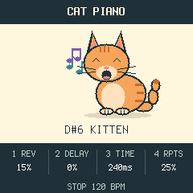

# Cat Piano

A cat piano for the M-VAVE FM-1: each of the 27 keys plays a real cat's meow, tuned to its note. Four banks of
cats, held notes that keep meowing, a pitch-bend knob, a 16-step loop, reverb and delay. Forked from
[Fart Machine One](https://github.com/adamcharleswilsonmusic-code/Fart-Machine-One), which is built on FoMni,
X0X and Felucca.



> **Status:** builds and passes its host tests. The first version (one bank) ran on an FM-1; this version
> (banks, sustain, bend) has not been installed on one yet.

## Controls

| Control | Behaviour |
| --- | --- |
| 27 keys | Play a meow at that key's note. Hold a key to keep it meowing; let go and it finishes. Up to eight overlap; the oldest is cut first. |
| PRESET | The bank: MEOW, KITTENS, TOMCATS, HUNGRY. The screen names it. |
| ALGO | Pitch bend, 10 cents a detent, up to 2 semitones either way. It springs back when you let go. |
| PLAY | Start the loop from step 1, or stop playback and recording and silence everything. |
| REC (tap) | Start recording from step 1 if stopped; during playback, overdub on or off. |
| REC (hold 1 s) | Clear the loop. |
| SELECT | Tempo, 40-240 BPM. |
| KNOB 1 / 2 / 3 / 4 | Reverb, delay level, delay time (80-500 ms), delay repeats (0-70%). |
| MASTER | Volume. |

One bar of 16 sixteenths, recorded to the nearest step. Each key has its own slot, so a loop remembers pitches.
Loop steps play each meow once through. The loop is kept in RAM only: switching off clears it.

MIDI in, channel 1: the bank's 27 notes (MEOW: 67-93) play the matching key with velocity; note-off lets it
finish. Pitch bend covers 2 semitones. CC 120 and 123 stop the loop and silence the sound.

## The cats

| Bank | Keys | Cats |
| --- | --- | --- |
| MEOW | G4-A6 | two takes per note, played in turn: Kerzoven's purry and soft mews, IgnasD's meow, AntumDeluge's kitten, a British Shorthair asking for food, Heismark's impatient cat |
| KITTENS | C5-D7 | small, high mews: a Greek street cat, Heismark, Kerzoven, the kitten |
| TOMCATS | G3-A5 | low and long: a Siamese, the British Shorthair, a pleading cat |
| HUNGRY | D4-E6 | Heismark's impatient and pleading cats |

Each bank has a take every three semitones, pitch-shifted to that note with its formants kept (so a cat sounds
like the same cat, not a chipmunk), and each key resamples its nearest take by a semitone at most. Takes are
stored as 22.05 kHz 2nd-order ADPCM (about 4.6 bits a sample, 27-58 dB SNR) with a sustain loop for held keys.
Sources, crops and licences: `samples/banks.json`, [LICENSING.md](LICENSING.md).

## Install

```sh
python3 -m venv .venv && . .venv/bin/activate
python -m pip install -r requirements-install.txt
python tools/fm1_install.py --info                 # finds the FM-1, changes nothing
python tools/fm1_install.py build/cat-piano.fwsc   # asks before it writes
```

The package identity is **FM-1_963**. To go back, use the [FM-1 Firmware Hub](https://thefirmwarehub.com) or
M-VAVE's updater. Holding OCT- while switching on starts the USB rescue. See [INSTALL.md](INSTALL.md).
Installing firmware is at your own risk.

## Build and test

See [BUILDING.md](BUILDING.md): the JieLi toolchain runs in a `linux/amd64` container on macOS.

```sh
sh tests/run_tests.sh      # host tests: pitch of every key, sustain, bend, DSP, codec, sequencer, UI, storage, USB
./build.sh                 # -> build/cat-piano.fwsc
```

`tests/fmo/demo.omni` renders a listening demo with the host simulator (`sh host/build_host.sh`, then
`build/host/omni_host tests/fmo/demo.omni build/demo`).

## Your own meows

Authoring needs numpy, ffmpeg and the [Rubber Band](https://breakfastquay.com/rubberband/) CLI (`brew install
rubberband`); the firmware build itself does not.

1. Put WAVs (16-bit PCM) under `samples/` and list each sound in `samples/banks.json` under `sources`: its
   `file`, a `start`/`end` crop in seconds, and `license`, `author` and `source`.
2. `python3 tools/measure_pitch.py samples/banks.json --write` measures each crop's pitch as `root_hz`. Check
   it by ear or on a spectrogram: meows glide. Add `"root_checked": "how"` to keep a value you set by hand.
3. Add the ids to a bank's `pool` (a bank: `name` of up to 10 characters, `note0` its lowest key, optional
   `takes` per anchor), then `python3 tools/render_banks.py` writes `samples/rendered/`.
4. `python3 tools/import_samples.py --banks samples/rendered/banks.json` writes the firmware bank, then
   `./build.sh`. Up to 8 banks and 460 KB of ADPCM (about 36 s of audio) fit.

## Licence

GPL-3.0-only, as the firmwares it comes from: give the source to anyone you give the firmware to. The meow
recordings are CC0 1.0 or public domain, except one under CC BY 4.0 whose attribution must travel with the
firmware. Credits and third-party notices are in [LICENSING.md](LICENSING.md). M-VAVE and FM-1 are trademarks
of their owners; this project is not affiliated with them.
